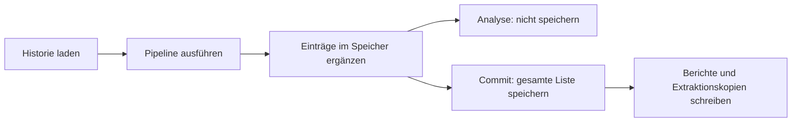

# Ledger, manuelle Entscheidungen und Berichte

## Historie

`scripts/ledger.py::Ledger` lädt eine JSON-Liste von `LedgerEntry`-Datensätzen. Jeder Eintrag enthält Dokument-ID, Datei-Hash, Lieferant, Rechnungsnummer und -datum, Bestellreferenz, Beträge, Gesamtmenge, Positionsfingerabdruck, normalisierte IBAN, automatische Entscheidung und UTC-Verarbeitungszeit.

Eine fehlende Datei bedeutet eine leere Historie. Eine ungültige vorhandene JSON-Datei wird nicht automatisch repariert. `save` schreibt die gesamte Liste neu; Datenbanktransaktionen, Dateisperren und atomare Austauschdateien sind nicht implementiert.

## Welche Dokumente werden erfasst?

Die Pipeline ergänzt für jede vorhandene Extraktion einen Eintrag, unabhängig von der Entscheidung. Damit können auch `hinschauen`-Belege und extrahierte Nicht-Rechnungen die spätere Historie beeinflussen. Es gibt an dieser Stelle keinen Filter „nur freigegebene Rechnungen“.

`record` hängt Einträge an, ohne vorherige Einträge zu ersetzen oder Duplikate abzuweisen. Ein wiederholter Commit kann dieselben Dokumente erneut hinzufügen. Die Prüfungen melden zwar Duplikate, verhindern das anschließende Anhängen aber nicht.

Bei gefundener Bestellung verwendet `ledger_entry_for` nur die Mengen der zur Bestellung passenden Positionen. Ohne gefundene Bestellung werden alle extrahierten Positionsmengen summiert. Historische Mengen berücksichtigen alle Entscheidungen und schließen Einträge mit der aktuellen Rechnungsnummer aus.

## Inhaltsfingerabdruck

`line_items_fingerprint` normalisiert Positionsbeschreibungen durch Kleinschreibung und äußeres Trimmen, rundet Mengen und Einzelpreise auf vier sowie Positionssummen auf zwei Nachkommastellen, sortiert die Tupel und bildet einen SHA-256-Hash des JSON-Texts. Rechnungsnummer, Datum, Lieferant und Layout gehören nicht zum Fingerabdruck.

`find_content_duplicate` sucht denselben Fingerabdruck unter anderer Rechnungsnummer. Sind beide Bruttobeträge vorhanden, darf ihre Differenz höchstens 0,02 € betragen.

## Vorschau und Übernahme

Jeder Aufruf lädt die Historie erneut. In einer Vorschau sehen spätere Dokumente die vorherigen desselben Laufs, ohne dass diese Ergänzungen dauerhaft gespeichert werden. Ein Commit führt den Lauf erneut aus und kann bei inzwischen geänderter Historie andere Ergebnisse liefern.

## Manuelle Entscheidungen

`overrides.py` speichert unter `results/overrides.json` pro `doc_id` die Entscheidung, Notiz, ursprüngliche automatische Entscheidung und einen UTC-Zeitpunkt. Eine erneute Übersteuerung derselben ID ersetzt den bisherigen Override; eine unveränderliche Versionshistorie gibt es nicht.

Die API zeigt `entscheidung` für das automatische Ergebnis und `endstatus` für das Ergebnis nach Override. Im Frontend gilt entsprechend `manual?.entscheidung ?? autoDecision`.

Wichtig für die Interpretation: Beim Web-Commit wird das Ledger durch die Pipeline bereits mit der **automatischen** Entscheidung gespeichert. Anschließend überlagert die API die Berichtszeilen mit manuellen Entscheidungen. Der Ledger-Status und der CSV-Endstatus können deshalb voneinander abweichen. Die CLI liest Overrides nicht ein.

## Ergebnisdateien

| Datei | Inhalt |
|---|---|
| `results/ergebnis.csv` | Semikolon-getrennte Tabelle mit UTF-8-BOM |
| `results/ergebnis.md` | Zusammenfassung und Detailbefunde |
| `results/extracted/<doc_id>.json` | Kopie der Rohdaten einer erfolgreichen Extraktion |
| `results/overrides.json` | Persistente manuelle Übersteuerungen |
| `.cache/extracted/<hash>.json` | Wiederverwendbare Rohdaten nach Dateiinhalt |
| `.cache/thumbs/` | Vorschaubilder der Web-API |

Die CSV-Spalten sind `doc_id`, `datei`, `entscheidung`, `lieferant`, `rechnungsnr`, `betrag_brutto_eur`, `bestellnummer`, `gruende`, `info_notes`, `quelle`, `automatisch_war` und `manuelle_notiz`. Bei normalen CLI-Zeilen bleiben die Zusatzspalten für manuelle Herkunft leer.

Bei gleicher Dokument-ID können Extraktionskopien und Overrides kollidieren. Berichte werden pro Lauf neu geschrieben; sie sind kein vollständiges Ereignisprotokoll aller bisherigen Läufe.

## Quellen

`scripts/ledger.py`, `scripts/pipeline.py::ledger_entry_for`, `scripts/pipeline.py::process_folder`, `scripts/overrides.py`, `scripts/report.py`, `api/app.py::_run`.

[Zur Übersicht](overview.md) · [HTTP-API](api.md)
