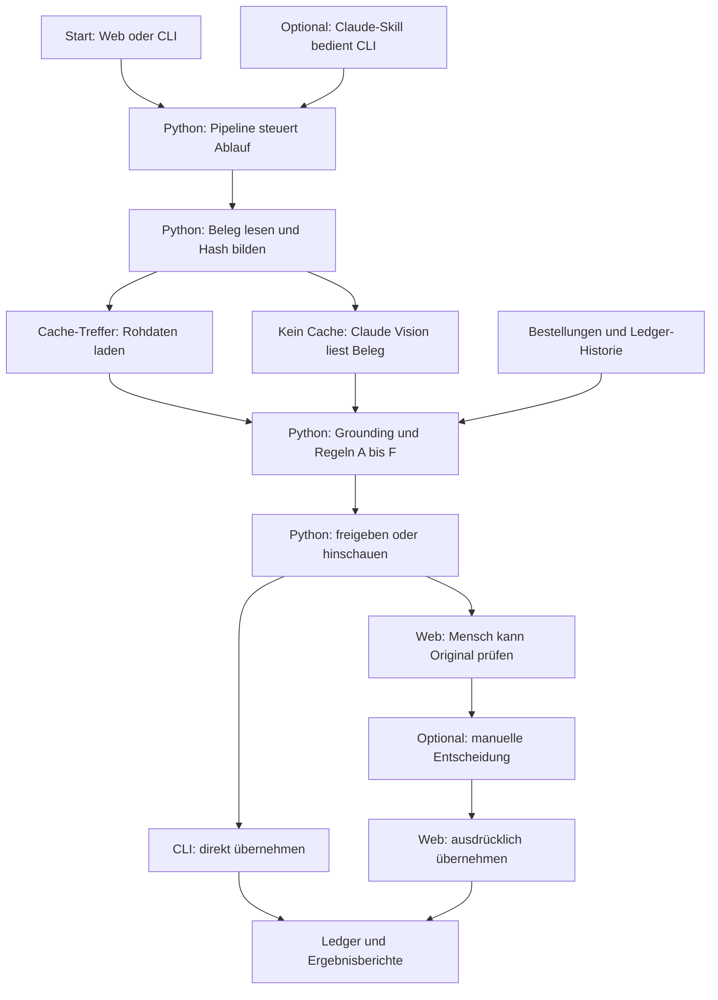
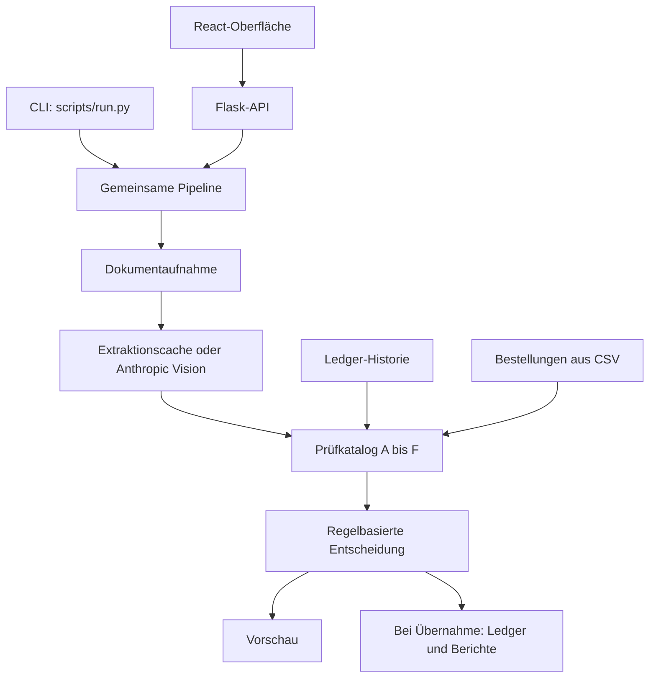

# Beleg-Prüfer: technische Dokumentation

Der Beleg-Prüfer analysiert Rechnungen für die Quellberg GmbH und liefert pro Dokument `freigeben` oder `hinschauen` mit nachvollziehbaren Prüfbefunden. Ein Sprachmodell extrahiert strukturierte Daten aus den Dokumentseiten. Die automatische Entscheidung entsteht anschließend ausschließlich durch Python-Regeln.

Diese Dokumentation beschreibt den gelesenen Quellstand vom 5. November 2026. Es wurde keine neue Rechnungsverarbeitung ausgeführt. Aussagen über Prüfungen beschreiben die Implementierung, keine unabhängige Bestätigung steuerlicher Vollständigkeit.

## KI, Agenten und Verantwortlichkeiten

Die Anwendung hat **eine KI-Extraktionsstufe**, aber keine Gruppe autonom zusammenarbeitender Prüfagenten. Claude Vision liest Belege und liefert strukturierte Rohdaten. Die Prüfbereiche A–F sind Python-Funktionen; die automatische Entscheidung berechnet `decide.py`. Ein optionaler Claude-Skill kann die CLI bedienen, ist aber kein zusätzliches Glied der fachlichen Prüfkette. CodeWiki dient ausschließlich der Erstellung dieser Dokumentation.

Die Cache-Zweige sind Alternativen: Bei einem Treffer entfällt der neue Vision-Aufruf. Im Web kann die automatische Entscheidung auch ohne manuellen Override übernommen werden; die manuelle Stufe ist optional. „Übernehmen“ startet die Pipeline erneut, nutzt dabei gegebenenfalls den Cache und schreibt die Historie. Eine Web-Analyse allein schreibt keine Ledger-Einträge auf die Festplatte.

| Rolle | Zuständigkeit | Implementierung |
|---|---|---|
| Orchestrierung | Aufnahme, Extraktion, Prüfungen und Speicherung koordinieren | `scripts/pipeline.py` |
| KI-Extraktion | Dokumentseiten in das JSON-Schema übertragen; keine Freigabe entscheiden | `scripts/extract.py` |
| Regelwerk | Formale Angaben, Rechenwerte, Bestellungen und Auffälligkeiten prüfen | `scripts/checks/` |
| Automatische Entscheidung | Aus blockierenden Befunden den Status berechnen | `scripts/decide.py` |
| Menschliche Prüfung | Original ansehen, Entscheidung gegebenenfalls übersteuern, Übernahme auslösen | Web-Oberfläche und `scripts/overrides.py` |
| Optionaler Bedienagent | Die vorhandene CLI anhand der Skill-Anleitung aufrufen | `SKILL.md` und `scripts/run.py` |

## Einstieg

| Kapitel | Inhalt |
|---|---|
| [Installation und Betrieb](betrieb.md) | Windows-Einrichtung, Demo, Live-Betrieb, CLI, Fehlerbehebung |
| [Pipeline und Extraktion](pipeline.md) | Dateiaufnahme, Vision-Aufruf, Cache, Reihenfolge |
| [Prüfkatalog und Entscheidung](pruefregeln.md) | A1–F2, Schwellenwerte, Grenzen der Umsetzung |
| [Ledger und Berichte](ledger.md) | Duplikate, Bestellmengen, manuelle Entscheidungen, Exporte |
| [HTTP-API](api.md) | Endpunkte, Datenvertrag, Schreibwirkungen |
| [Web-Oberfläche](frontend.md) | Seiten, Live-/Demo-Adapter, Browserzustand |
| [Evaluation und Wartung](evaluation.md) | vorhandene Auswertung, Erweiterungspunkte, bekannte Einschränkungen |

## Architektur

## Verzeichnisstruktur

| Pfad | Aufgabe |
|---|---|
| `scripts/run.py` | Kommandozeilen-Einstieg |
| `scripts/pipeline.py` | Gemeinsame Orchestrierung für CLI und API |
| `scripts/intake.py`, `extract.py`, `normalize.py` | Aufnahme, Extraktion, Textabgleich |
| `scripts/checks/`, `scripts/decide.py` | Befunde und automatische Entscheidung |
| `scripts/ledger.py`, `po.py`, `report.py`, `overrides.py` | Historie, Bestellungen, Export und Übersteuerung |
| `api/app.py` | Lokale JSON-API |
| `web/` | React-/TanStack-Oberfläche |
| `config.yaml` | Firmenangaben, Modell, Policies und Pfade |
| `belege/`, `ledger/`, `results/` | Eingaben, gespeicherte Historie und Ergebnisse |
| `eval/` | Vergleich mit Ground Truth und Generatoren für Testmaterial |

## Drei Bedienwege

1. **Web:** Analysieren, Original prüfen, gegebenenfalls manuell entscheiden und anschließend ins Ledger übernehmen.
2. **CLI:** Einen Ordner vollständig verarbeiten und das Ergebnis unmittelbar ins Ledger schreiben.
3. **Claude-Skill:** Die vorhandene `SKILL.md` dient als Bedienbeschreibung für einen Agenten, der die CLI aufruft.

Die Web-Vorschau lädt die persistente Historie frisch, verändert aber nur das Ledger im Arbeitsspeicher. Extraktions- und Vorschaubild-Caches können trotzdem auf die Festplatte geschrieben werden. Die Übernahme ist ein neuer Pipeline-Lauf; sie bestätigt kein unveränderliches Vorschauobjekt.

## Zentrale Eigenschaften

- Nicht bestandene `BLOCK`-Befunde führen zu `hinschauen`; alle übrigen Befunde bleiben zur Erläuterung sichtbar.
- Ein Dokument ohne Extraktion führt zu einem Lesbarkeitsbefund, statt eine Modellentscheidung zu übernehmen.
- Die Historie berücksichtigt auch vorherige Dokumente desselben Laufs.
- Manuelle Entscheidungen bleiben getrennt vom automatischen Ergebnis gespeichert.
- Eine Freigabe löst keine Bankzahlung und keinen Export in ein Buchhaltungssystem aus.

## Quellen

Maßgeblich sind `README.md`, `scripts/pipeline.py`, `scripts/checks/__init__.py`, `scripts/decide.py`, `api/app.py` und `web/src/lib/beleg-store.tsx`. Die Kapitel nennen weitere Quelldateien und konkrete Funktionen.
